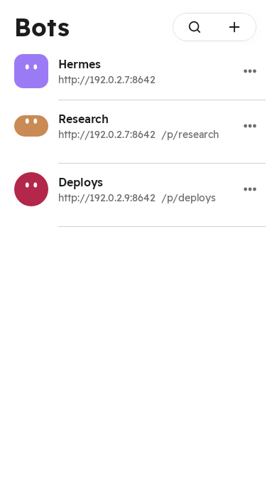
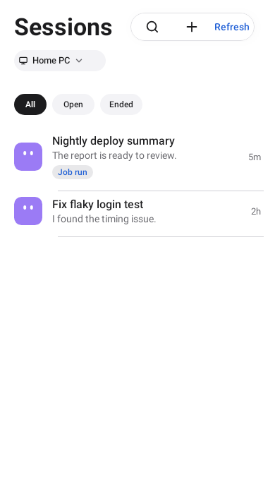
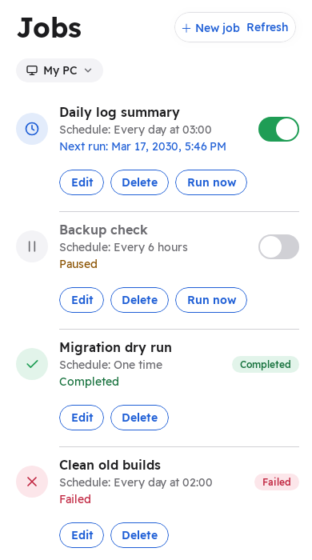

# Rasul (رسول)

**Control your Hermes Agent from your Android phone.**

Rasul is a free, open-source Android app for people who run [Hermes Agent](https://github.com/NousResearch/hermes-agent) on their own computer. It connects to the Hermes API server on your PC so you can chat with your agent, follow its work live, answer its approval requests and manage its jobs from anywhere.

Rasul is an **unofficial** client. It is not made by or affiliated with Nous Research.

English | [العربية](#العربية)

| Bots | Sessions | Jobs |
|---|---|---|
|  |  |  |

## What it does

- **Chat with your agent.** Send a task, watch the reply and the tool progress stream in live.
- **Steer or stop a running task.** A message sent while the agent works is added to the running task. Stop ends it.
- **Approvals.** When the agent asks before running something, approve once or deny from the phone.
- **Sessions.** Browse past conversations and read their transcripts.
- **Jobs.** See scheduled jobs, pause, resume or run one now.
- **Several PCs and profiles.** Save each computer once and switch between them. Hermes profiles (`/p/<profile>/`) are supported.
- **English and Arabic.** Pick the language in the app. Arabic is fully right-to-left.
- **Light and dark theme.**
- **App lock.** Protect the app with your phone’s screen lock or a strong biometric.

There is no Rasul server. The app talks only to your own computer. No accounts, no tracking, no analytics, no ads.

## Status

Early development (version 0.2.1). Pre-release APKs are on the Releases page. Planned next: a file view for what the agent produces, once the Hermes API offers one.

## Requirements

- Hermes Agent **v0.22.0 or newer** on your computer, with a working model provider.
- An Android phone with Android 8.0 (API 26) or newer.
- An authenticated HTTPS endpoint for access from the phone.

## Rasul Bridge (recommended)

Use [Rasul Bridge](bridge/README.md) for the recommended pinned TLS companion protocol. It keeps profile keys on the computer and supports local device pairing and revocation. This package provides the computer side; the app pairs with it by scanning its QR code. Direct Hermes connections remain the advanced option described below.

## Approvals from computer sessions

The optional [phone approval integration](docs/bridge-approvals.md) adds computer-side routes for listing and answering pending approvals while keeping the local approval card active. Setup requires a profile plugin and a separate private bridge listener. The phone feed UI is a later slice.

## Direct Hermes connection (advanced)

1. Turn on the Hermes API server. Add these lines to `~/.hermes/.env` on your computer:

   ```
   API_SERVER_ENABLED=true
   API_SERVER_KEY=<a long random secret>
   ```

   Create the secret with a password manager or, for example, `openssl rand -hex 32`. Treat it like a password.

2. Publish the local API through an authenticated HTTPS endpoint with a trusted certificate (for example `https://example.com`). Private and overlay network addresses also require HTTPS. Plain HTTP is restricted to the phone’s loopback interface.

3. Restart the Hermes gateway (`hermes gateway`).

See the [Hermes API server documentation](https://github.com/NousResearch/hermes-agent) for all options.

## Connect the app

1. Open Rasul and tap the add button on the **Bots** tab.
2. Enter a name, the address (for example `https://example.com`), the profile if you use one, and the API key.
3. Tap **Test connection**. Rasul checks the server and which features it supports.
4. Save, then tap the bot to open the chat.

To use the bridge instead, run its pairing command on the computer and tap **Pair a bridge** in the app and scan the QR code. Credential-bearing pairing links are no longer accepted.

## Security

**The API key gives full control of your computer.** Anyone with the address and the key can make the agent run terminal commands and change files.

- Never expose the Hermes API server to the public internet. Use Tailscale or your home network.
- Direct connections require `https`, except the phone’s loopback interface. Private and overlay network addresses also require `https`.
- The key is encrypted with a key held in the Android Keystore and is excluded from phone backups.
- The app does not follow redirects, so a server cannot silently send your key elsewhere.

Found a security problem? Please open a private security advisory on this repository instead of a public issue.

## Build from source

Requirements: JDK 21 and the Android SDK (API 35).

```
git clone <this repository URL>
cd rasul
echo "sdk.dir=/path/to/Android/sdk" > local.properties
./gradlew :app:assembleDebug
```

The debug APK is written to `app/build/outputs/apk/debug/`.

### Tests

- Unit tests: `./gradlew :app:testDebugUnitTest`
- Screenshot tests run on the JVM (Roborazzi + Robolectric), with no device. Every screen preview is captured in English and Arabic, plus the Bots list in dark mode, to `app/src/test/screenshots/`.
  - Record new images: `./gradlew :app:recordRoborazziDebug`
  - Check against the committed images: `./gradlew :app:verifyRoborazziDebug`

Built with Kotlin, Jetpack Compose (Material 3), OkHttp, kotlinx.serialization and DataStore.

**Fonts:** Readex Pro, IBM Plex Sans Arabic and IBM Plex Mono are licensed under the SIL Open Font License 1.1; see `third_party/fonts/`.

## Contributing

Issues and pull requests are welcome. Please keep each pull request to one change, add tests for behaviour changes, keep English and Arabic strings in step, and run the unit and screenshot tests before you open it.

## License

[Apache License 2.0](LICENSE).

Hermes Agent is a project of Nous Research. "Hermes" is used here only to name the software this app connects to.

---

<div dir="rtl">

## العربية

# رسول

**تحكّم بوكيل Hermes من هاتف أندرويد.**

رسول تطبيق أندرويد مجاني ومفتوح المصدر لمن يشغّل [Hermes Agent](https://github.com/NousResearch/hermes-agent) على حاسوبه. يتصل بخادم Hermes API على حاسوبك، فتستطيع محادثة الوكيل ومتابعة عمله مباشرة والرد على طلبات الموافقة وإدارة المهام المجدولة من أي مكان.

رسول تطبيق **غير رسمي**، ولا علاقة له بشركة Nous Research.

### ماذا يقدّم

- **المحادثة مع الوكيل:** أرسل مهمة وتابع الرد وتقدّم الأدوات لحظة بلحظة.
- **توجيه المهمة الجارية أو إيقافها:** الرسالة التي ترسلها أثناء عمل الوكيل تُضاف إلى المهمة الجارية، وزر الإيقاف ينهيها.
- **الموافقات:** عندما يطلب الوكيل الإذن قبل تنفيذ أمر، وافق مرة واحدة أو ارفض من الهاتف.
- **الجلسات:** تصفّح المحادثات السابقة واقرأ نصوصها.
- **المهام المجدولة:** اعرض المهام، أوقفها مؤقتًا، استأنفها أو شغّلها الآن.
- **أكثر من حاسوب وملف تعريف:** احفظ كل حاسوب مرة واحدة وبدّل بينها، مع دعم ملفات تعريف Hermes.
- **العربية والإنجليزية:** اختر اللغة من داخل التطبيق، والواجهة العربية من اليمين إلى اليسار بالكامل.
- **الخطوط:** Readex Pro وIBM Plex Sans Arabic وIBM Plex Mono مرخّصة بموجب رخصة SIL Open Font License 1.1؛ راجع `third_party/fonts/`.
- **سمة فاتحة وداكنة.**

لا يوجد خادم لرسول. التطبيق يتصل بحاسوبك فقط، بلا حسابات ولا تتبّع ولا تحليلات ولا إعلانات.

### الحالة

قيد التطوير المبكر (الإصدار 0.2.1). ملفات APK التجريبية متاحة في صفحة الإصدارات.

### جسر رسول (موصى به)

يوفّر [جسر رسول](bridge/README.md) بروتوكول اتصال مشفّرًا مع تثبيت هوية الحاسوب، وإقران الأجهزة وإلغاء وصولها محليًا، مع بقاء مفاتيح ملفات التعريف على الحاسوب. هذه الحزمة توفّر جانب الحاسوب، ويقترن بها التطبيق بمسح رمز QR الذي تعرضه. يصبح الاتصال المباشر بـ Hermes الخيار المتقدّم الموضّح أدناه.

### الاتصال المباشر بـ Hermes (خيار متقدّم)

1. فعّل خادم Hermes API بإضافة هذين السطرين إلى الملف `~/.hermes/.env`:

   ```
   API_SERVER_ENABLED=true
   API_SERVER_KEY=<سر طويل عشوائي>
   ```

   أنشئ السر بمدير كلمات المرور أو بالأمر `openssl rand -hex 32`، وعامله ككلمة مرور.

2. أتح الوصول إلى واجهة API المحلية عبر عنوان HTTPS بشهادة موثوقة، مثل `https://example.com`. تتطلب عناوين الشبكات الخاصة HTTPS أيضًا. يُسمح باتصال HTTP غير المشفّر فقط مع واجهة الاسترجاع على الهاتف نفسه.

3. أعد تشغيل Hermes بالأمر `hermes gateway`.

### ربط التطبيق

1. افتح رسول واضغط زر الإضافة في تبويب **الروبوتات**.
2. أدخل اسمًا والعنوان (مثل `https://example.com`) وملف التعريف إن وُجد ومفتاح API.
3. اضغط **اختبار الاتصال**، ثم احفظ واضغط على الروبوت لفتح المحادثة.

لاستخدام الجسر، شغّل أمر الإقران على الحاسوب ثم اضغط **إقران جسر** في التطبيق وامسح رمز QR. لم يعد التطبيق يقبل روابط الإقران التي تحتوي على مفتاح API.

### الأمان

**مفتاح API يمنح تحكمًا كاملًا بحاسوبك:** من يملك العنوان والمفتاح يستطيع جعل الوكيل ينفّذ أوامر ويعدّل الملفات.

- لا تعرّض خادم Hermes API للإنترنت العام أبدًا، واستخدم Tailscale أو شبكة المنزل.
- يتطلب الاتصال المباشر HTTPS، باستثناء واجهة الاسترجاع على الهاتف نفسه.
- يُخزَّن المفتاح مشفّرًا بمفتاح من Android Keystore ولا يدخل في النسخ الاحتياطي للهاتف.

### الترخيص

[رخصة Apache 2.0](LICENSE).

</div>
